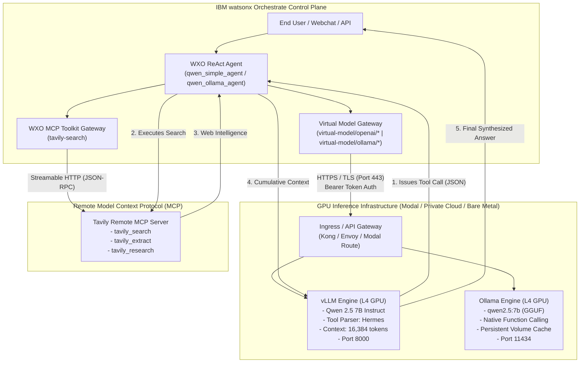

<div align="center">

# 🚀 Enterprise Self-Hosted Models & Remote MCP in IBM watsonx Orchestrate

### *Empowering Autonomous Enterprise Agents with On-Prem / Serverless Qwen 2.5, vLLM, Ollama, and Tavily MCP Web Search*

[](https://www.ibm.com/products/watsonx-orchestrate)
[](https://github.com/vllm-project/vllm)
[](https://ollama.com/)
[](https://huggingface.co/Qwen/Qwen2.5-7B-Instruct)
[-blue)](https://modelcontextprotocol.io/)
[](https://modal.com/)
[](https://opensource.org/licenses/MIT)

</div>

---

## 📖 Table of Contents
- [1. Executive Narrative: The On-Premises Agent Revolution](#1-executive-narrative-the-on-premises-agent-revolution)
- [2. System Architecture](#2-system-architecture)
- [3. Deep Dive: Serving Engines (vLLM vs. Ollama)](#3-deep-dive-serving-engines-vllm-vs-ollama)
  - [vLLM: High-Throughput Production Engine](#vllm-high-throughput-production-engine)
  - [Ollama: Agile Quantized Inference](#ollama-agile-quantized-inference)
- [4. Extending Agents with Remote MCP (Tavily Search)](#4-extending-agents-with-remote-mcp-tavily-search)
- [5. Repository Structure](#5-repository-structure)
- [6. Step-by-Step Deployment Guide](#6-step-by-step-deployment-guide)
  - [Prerequisites](#prerequisites)
  - [Step 1: Deploy GPU Inference on Modal](#step-1-deploy-gpu-inference-on-modal)
  - [Step 2: Environment Configuration](#step-2-environment-configuration)
  - [Step 3: Automated Setup Script](#step-3-automated-setup-script)
  - [Step 4: Manual Step-by-Step (Optional)](#step-4-manual-step-by-step-optional)
- [7. Verification & Interactive Chat](#7-verification--interactive-chat)
- [8. Production Engineering & Lessons Learned](#8-production-engineering--lessons-learned)
  - [The Context Window Trap & Resolution](#the-context-window-trap--resolution)
  - [Mitigating Cold Starts (Keep-Warm Cron)](#mitigating-cold-starts-keep-warm-cron)
- [9. Contributing & License](#9-contributing--license)

---

## 1. Executive Narrative: The On-Premises Agent Revolution

In enterprise AI deployment, organizations face a critical dilemma: **How can we build advanced, autonomous reasoning agents while maintaining strict data governance, IP confidentiality, and sovereign control?**

While frontier cloud models (such as GPT-4 or Claude 3.5) offer powerful capabilities, regulated industries—including finance, healthcare, defense, and cybersecurity—frequently prohibit transmitting internal tokens and proprietary customer context across multi-tenant third-party cloud APIs.

Enter **open-weight foundation models**. With the release of **Qwen 2.5 (by Alibaba Cloud)**, open models now demonstrate competitive function-calling accuracy, rigorous structured JSON generation, and mathematical reasoning that rival proprietary models.

```
                  ┌────────────────────────────────────────────────────────┐
                  │                 The Enterprise Dilemma                 │
                  └───────────────────────────┬────────────────────────────┘
                                              │
                    ┌─────────────────────────┴─────────────────────────┐
                    ▼                                                   ▼
       ❌ Multi-Tenant Public LLMs                         ✅ Private / Self-Hosted Models
       - Data privacy concerns                             - 100% Data Sovereignty
       - Vendor lock-in & API throttling                   - Zero external prompt leakage
       - Unpredictable pricing curves                      - Predictable compute costs
       - Black-box infrastructure                          - Auditable, fine-tunable weights
```

This repository delivers an end-to-end reference implementation for connecting **self-hosted Qwen 2.5 models** directly into **IBM watsonx Orchestrate (WXO)** via its **Virtual Model architecture**, augmented with **real-time web search and content extraction** through a remote **Model Context Protocol (MCP)** server.

---

## 2. System Architecture

The architecture decouples the **agent orchestration control plane** from the **underlying compute infrastructure**, allowing organizations to host their models on-premises (OpenShift / Red Hat CP4D), in private clouds, or on serverless GPU runtimes (Modal) with zero loss of orchestrator capabilities.



---

## 3. Deep Dive: Serving Engines (vLLM vs. Ollama)

We provide parallel implementations for two leading open-source LLM serving engines:

| Feature / Metric | vLLM (`modal_vllm_qwen.py`) | Ollama (`modal_ollama_qwen.py`) |
| :--- | :--- | :--- |
| **Target Workload** | High-throughput, multi-agent production | Rapid prototyping, edge nodes, sandboxes |
| **Model Precision** | Unquantized BF16 / FP8 safetensors | GGUF Quantized (Q4_K_M) |
| **Memory Optimization** | PagedAttention + Continuous Batching | System-level slot allocation |
| **Tool Calling Parser** | Explicit Hermes parser (`--tool-call-parser hermes`) | Built-in template parser |
| **WXO Provider Spec** | `openai` (`virtual-model/openai/...`) | `ollama` (`virtual-model/ollama/...`) |
| **WXO Authentication** | External Team Connection (`connections` CLI) | Static `api_key` in model specification |
| **Context Window Configured** | **16,384 tokens** (prevents tool overflow) | **4,096 tokens** |

### vLLM: High-Throughput Production Engine
vLLM utilizes **PagedAttention**, an algorithm that manages KV cache memory with virtually zero memory fragmentation. In our setup, Qwen 2.5 7B Instruct runs on an NVIDIA L4 GPU with:
- `--enable-auto-tool-choice`: Enables automatic function calling.
- `--tool-call-parser hermes`: Translates Qwen's Hermes-style tool prompts and outputs into standard OpenAI tool call schemas.
- `--max-model-len 16384`: Expands the KV context window to handle large multi-source search summaries.

### Ollama: Agile Quantized Inference
Ollama runs the 4-bit quantized GGUF weights of `qwen2.5:7b` inside a container backed by a persistent Modal Volume (`ollama-models-cache`). Upon first boot, the model is cached so that subsequent cold starts initialize in seconds.

---

## 4. Extending Agents with Remote MCP (Tavily Search)

Foundation models alone lack knowledge of real-time events, live CVE databases, or dynamic external data. Rather than building proprietary plugins, this architecture uses the **Model Context Protocol (MCP)** over **Streamable HTTP**.

WXO connects to Tavily's remote MCP server (`https://mcp.tavily.com/mcp/?tavilyApiKey=...`) and registers five autonomous tools:
1. `tavily-search:tavily_search`: Real-time web search returning snippets, scores, and source URLs.
2. `tavily-search:tavily_extract`: Clean markdown extraction from web pages.
3. `tavily-search:tavily_research`: Multi-source deep research on complex topics.
4. `tavily-search:tavily_map`: Structure and link mapping for domain targets.
5. `tavily-search:tavily_crawl`: Recursive site crawler with configurable depth.

---

## 5. Repository Structure

```
.
├── ON_PREM_MODEL_DEPLOYMENT_GUIDE.md  # Comprehensive enterprise architecture blueprint
├── README.md                          # You are here: blog-style guide & documentation
├── workspace_config.yaml              # watsonx Orchestrate folder mappings
├── .env.example                       # Environment variable template
├── .gitignore                         # Sanitized ignore rules
│
├── modal_vllm_qwen.py                 # Modal deployment script for vLLM (Qwen 2.5 7B, L4 GPU)
├── modal_ollama_qwen.py               # Modal deployment script for Ollama (Qwen 2.5 7B, L4 GPU)
│
├── models/
│   ├── qwen2.5-modal.yaml             # WXO Virtual Model definition (vLLM OpenAI provider)
│   ├── qwen2.5-modal.yaml.template    # Environment-variable ready template
│   ├── qwen2.5-ollama.yaml            # WXO Virtual Model definition (Ollama provider)
│   ├── qwen2.5-ollama.yaml.template   # Environment-variable ready template
│   └── qwen2.5-vllm.yaml              # Reference on-prem LAN IP vLLM definition
│
├── agents/
│   ├── qwen-assistant.yaml            # ReAct agent powered by vLLM + Tavily MCP tools
│   └── qwen-ollama-agent.yaml         # ReAct agent powered by Ollama + Tavily MCP tools
│
├── toolkits/
│   ├── tavily-search.yaml             # Tavily Remote MCP streamable_http toolkit
│   └── tavily-search.yaml.template    # Template for dynamic API key injection
│
└── scripts/
    ├── setup_orchestrate.sh           # Automated end-to-end WXO registration script
    └── keepwarm_ping.sh               # Lightweight heartbeat pinger for demo keep-warm
```

---

## 6. Step-by-Step Deployment Guide

### Prerequisites
1. **Python 3.11+** installed locally.
2. **Modal Account & CLI** (`pip install modal && modal setup`).
3. **IBM watsonx Orchestrate Tenant** with an **IBM Cloud IAM API Key**.
4. **Tavily Search API Key** (obtainable from [tavily.com](https://tavily.com)).
5. **watsonx Orchestrate ADK** (`pip install ibm-watsonx-orchestrate`).

---

### Step 1: Deploy GPU Inference on Modal

Deploy both serverless GPU apps to Modal with a single command:

```bash
# 1. Deploy vLLM server (NVIDIA L4, 16K context, Hermes parser)
modal deploy modal_vllm_qwen.py

# 2. Deploy Ollama server (NVIDIA L4, volume cache)
modal deploy modal_ollama_qwen.py
```

Modal will return two public HTTPS URLs:
- vLLM: `https://<username>--vllm-qwen-orchestrate-serve.modal.run`
- Ollama: `https://<username>--ollama-qwen-orchestrate-serve.modal.run`

---

### Step 2: Environment Configuration

Copy the `.env.example` file and configure your credentials:

```bash
cp .env.example .env
```

Edit `.env` with your values:
```bash
WXO_INSTANCE_URL=https://api.eu-de.watson-orchestrate.cloud.ibm.com/instances/<YOUR_INSTANCE_ID>
WXO_API_KEY=<YOUR_IBM_IAM_API_KEY>
WXO_ENV_NAME=frankfurt-prod

VLLM_HOST_URL=https://<username>--vllm-qwen-orchestrate-serve.modal.run/v1
VLLM_API_KEY=qwen-orchestrate-token
OLLAMA_HOST_URL=https://<username>--ollama-qwen-orchestrate-serve.modal.run

TAVILY_API_KEY=tvly-your-actual-key
```

---

### Step 3: Automated Setup Script

Run the automated setup script to provision connections, models, tools, and agents into WXO:

```bash
chmod +x scripts/setup_orchestrate.sh
./scripts/setup_orchestrate.sh
```

The script performs the following tasks:
1. Connects and authenticates your Orchestrate environment.
2. Creates the `qwen_modal_creds` connection with bearer credentials in `draft` and `live`.
3. Validates and registers both Virtual Models (running automated invocation, streaming, and tool-calling tests).
4. Injects your Tavily API key and imports the `tavily-search` MCP toolkit.
5. Deploys `qwen_simple_agent` and `qwen_ollama_agent` into the live environment.

---

### Step 4: Manual Step-by-Step (Optional)

If you prefer executing commands manually via the `orchestrate` CLI:

<details>
<summary><b>Click to expand manual CLI commands</b></summary>

```bash
# 1. Add and activate environment
orchestrate env add -n my-env --url $WXO_INSTANCE_URL --type ibm_iam
orchestrate env activate my-env --api-key $WXO_API_KEY

# 2. Setup connection credentials
orchestrate connections add --app-id qwen_modal_creds
orchestrate connections configure --app-id qwen_modal_creds --env draft --type team --kind key_value
orchestrate connections configure --app-id qwen_modal_creds --env live --type team --kind key_value
orchestrate connections set-credentials --app-id qwen_modal_creds --env draft -e api_key=qwen-orchestrate-token
orchestrate connections set-credentials --app-id qwen_modal_creds --env live -e api_key=qwen-orchestrate-token

# 3. Import and validate models
orchestrate models import --file models/qwen2.5-modal.yaml --app-id qwen_modal_creds
orchestrate models import --file models/qwen2.5-ollama.yaml

# 4. Import Tavily MCP toolkit
orchestrate toolkits import --file toolkits/tavily-search.yaml

# 5. Import and deploy agents
orchestrate agents import --file agents/qwen-assistant.yaml
orchestrate agents deploy --name qwen_simple_agent

orchestrate agents import --file agents/qwen-ollama-agent.yaml
orchestrate agents deploy --name qwen_ollama_agent
```
</details>

---

## 7. Verification & Interactive Chat

Test the autonomous tool-calling capabilities directly from your terminal:

```bash
# Test vLLM agent with multi-step search & reasoning
orchestrate chat ask -n qwen_simple_agent \
  "What is the capital of France and what is the current weather there? Search using Tavily." \
  --include-reasoning
```

### Actual Execution Trace:
```
[INFO] - Using agent: qwen_simple_agent
╭─ 👤 User ────────────────────────────────────────────────────────────────────╮
│  What is the capital of France and what is the current weather there?        │
│  Search using Tavily.                                                        │
╰──────────────────────────────────────────────────────────────────────────────╯
╭─ 🧠 Reasoning Trace ─────────────────────────────────────────────────────────╮
│  Step 1: Called tool 'tavily_search' (query: 'capital of France')            │
│  Step 2: Tool 'tavily_search' responded -> [Paris, Île-de-France...]         │
│  Step 3: Called tool 'tavily_search' (query: 'current weather in Paris')     │
│  Step 4: Tool 'tavily_search' responded -> [Temp: 20.4°C, Overcast, Hum: 68%]│
╰──────────────────────────────────────────────────────────────────────────────╯
╭─ 🤖 qwen_simple_agent ───────────────────────────────────────────────────────╮
│  The capital of France is Paris.                                             │
│  As of the latest information, the current weather in Paris is:              │
│  - Temperature: 20.4°C (68.6°F)                                              │
│  - Condition: Overcast, Humidity: 68%                                        │
│  - Wind: 8.7 mph from the South                                              │
╰──────────────────────────────────────────────────────────────────────────────╯
```

---

## 8. Production Engineering & Lessons Learned

### The Context Window Trap & Resolution
* **The Symptom**: When an agent conducted multi-step searches (e.g., searching for the capital, then searching for weather), the second generation step threw an HTTP `400 Bad Request` from vLLM.
* **The Root Cause**: WXO injects full JSON schemas for all available toolkit functions (~3,000 tokens), plus prior conversation turns, plus the search engine output. If `max-model-len` is set to `8192` and the model is configured with `max_completion_tokens: 4096`, any prompt exceeding `4096` tokens will cause:
  $$\text{Prompt Tokens} + \text{Max Completion Tokens} > \text{Max Model Length}$$
  vLLM immediately rejects this overflow with HTTP 400.
* **The Fix**:
  1. We increased vLLM's `--max-model-len` to **`16384`** in `modal_vllm_qwen.py`. On an NVIDIA L4 (24GB VRAM), Qwen 2.5 7B's KV cache only consumes **5.46 GiB**, leaving abundant headroom.
  2. We adjusted `max_completion_tokens` to **`1500`** in `models/qwen2.5-modal.yaml` to guarantee safe completion budgets.

### Mitigating Cold Starts (Keep-Warm Cron)
Serverless GPU containers scale down to 0 after 5 minutes of idle time (`scaledown_window=300`) to conserve compute credits. Cold-starting a 14GB model takes approximately 30–40 seconds. 

For high-profile demos or critical windows, run our keep-warm utility:

```bash
chmod +x scripts/keepwarm_ping.sh
./scripts/keepwarm_ping.sh 180  # Pings every 3 minutes
```

---

## 9. Contributing & License

Contributions, issues, and feature requests are welcome!

1. Fork the Project
2. Create your Feature Branch (`git checkout -b feature/AmazingFeature`)
3. Commit your Changes (`git commit -m 'Add AmazingFeature'`)
4. Push to the Branch (`git push origin feature/AmazingFeature`)
5. Open a Pull Request

Distributed under the **MIT License**. See `LICENSE` for more information.

---

<div align="center">
Built with ❤️ for the Enterprise AI & watsonx Orchestrate Community.
</div>
